# 🗄️ Especificação de Banco de Dados — AutoGest

Este documento contém o Diagrama Entidade-Relacionamento (ER) consolidado e o Dicionário de Dados detalhado das tabelas relacionais do **PostgreSQL** e do armazenamento local **SQLite** da aplicação **AutoGest**.

---

## 📐 1. Diagrama Entidade-Relacionamento (ER)

```mermaid
erDiagram
    USUARIOS ||--o{ VEICULOS : "possui"
    USUARIOS ||--o{ AUDITORIA : "registra acoes"
    USUARIOS ||--o{ PREFERENCIAS : "configura"
    USUARIOS ||--o{ NOTIFICACOES_AGENDADAS : "recebe"
    USUARIOS ||--o{ FILA_SYNC : "enfileira"

    VEICULOS ||--o{ ABASTECIMENTOS : "registra"
    VEICULOS ||--o{ LEITURAS_HODOMETRO : "registra"
    VEICULOS ||--o{ DESPESAS : "possui"
    VEICULOS ||--o{ MANUTENCOES : "historico"
    VEICULOS ||--o{ REGRAS_MANUTENCAO : "configura"
    VEICULOS ||--o{ CUSTOS_FIXOS : "possui"
    VEICULOS ||--o{ REGISTROS_PNEU : "monitora"
    VEICULOS ||--o{ REGISTROS_FLUIDO : "monitora"
    VEICULOS ||--o{ ORCAMENTOS : "possui teto"
    VEICULOS ||--o{ VIAGENS : "realiza"
    VEICULOS ||--o{ METAS_EFICIENCIA : "define"
    VEICULOS ||--o{ CONSULTAS_FIPE : "historico cotacao"
    VEICULOS ||--o{ AGENDAMENTOS_MANUTENCAO : "agenda"

    MANUTENCOES ||--o{ ANEXOS : "anexa"
    MANUTENCOES ||--o| AGENDAMENTOS_MANUTENCAO : "conclui"
    VIAGENS ||--o{ ABASTECIMENTOS : "associa"
    VIAGENS ||--o{ DESPESAS : "associa"

    ETIQUETAS ||--o{ REGISTROS_ETIQUETAS : "categoriza"

    USUARIOS {
        uuid id PK
        string firebase_uid UK
        string email UK
        string nome
        timestamp criado_em
        timestamp atualizado_em
        timestamp excluido_em
    }

    VEICULOS {
        uuid id PK
        uuid usuario_id FK
        string placa UK
        string modelo
        integer ano
        decimal capacidade_tanque_l
        string combustivel_preferencial
        decimal hodometro_inicial
        decimal hodometro_atual
        decimal valor_fipe_atual
        string fipe_marca_codigo
        string fipe_modelo_codigo
        string fipe_ano_codigo
        timestamp criado_em
        timestamp atualizado_em
        timestamp excluido_em
    }

    ABASTECIMENTOS {
        uuid id PK
        uuid veiculo_id FK
        uuid viagem_id FK
        timestamp data_hora
        string tipo_combustivel
        decimal litros
        decimal valor_total
        decimal valor_litro
        decimal km
        boolean tanque_cheio
        decimal consumo_kml
        string tipo_percurso
        string posto_nome
        decimal latitude
        decimal longitude
        string comprovante_url
        string nota
        timestamp criado_em
        timestamp atualizado_em
        timestamp excluido_em
    }

    LEITURAS_HODOMETRO {
        uuid id PK
        uuid veiculo_id FK
        decimal km
        timestamp data_hora
        string origem
        timestamp criado_em
        timestamp atualizado_em
        timestamp excluido_em
    }

    DESPESAS {
        uuid id PK
        uuid veiculo_id FK
        uuid viagem_id FK
        string categoria
        string subtipo_viagem
        decimal valor
        date data
        string descricao
        timestamp criado_em
        timestamp atualizado_em
        timestamp excluido_em
    }

    CUSTOS_FIXOS {
        uuid id PK
        uuid veiculo_id FK
        string descricao
        decimal valor_mensal
        timestamp criado_em
        timestamp atualizado_em
        timestamp excluido_em
    }

    MANUTENCOES {
        uuid id PK
        uuid veiculo_id FK
        date data
        decimal km
        string tipo
        string tipo_servico
        string descricao
        string pecas
        string oficina
        string profissional
        integer tempo_execucao_min
        decimal valor
        string nota
        timestamp criado_em
        timestamp atualizado_em
        timestamp excluido_em
    }

    ANEXOS {
        uuid id PK
        uuid manutencao_id FK
        string nome_arquivo
        string url_gcs
        integer tamanho_bytes
        string mime_type
        string status_upload
        timestamp criado_em
        timestamp atualizado_em
        timestamp excluido_em
    }

    REGRAS_MANUTENCAO {
        uuid id PK
        uuid veiculo_id FK
        string tipo_servico
        integer intervalo_km
        integer intervalo_dias
        integer antecedencia_km
        integer antecedencia_dias
        boolean ativa
        timestamp criado_em
        timestamp atualizado_em
        timestamp excluido_em
    }

    REGISTROS_PNEU {
        uuid id PK
        uuid veiculo_id FK
        date data
        decimal km
        string tipo
        decimal pressao_psi
        decimal sulco_mm
        timestamp criado_em
        timestamp atualizado_em
        timestamp excluido_em
    }

    REGISTROS_FLUIDO {
        uuid id PK
        uuid veiculo_id FK
        string tipo_fluido
        date data
        decimal km
        string nivel
        timestamp criado_em
        timestamp atualizado_em
        timestamp excluido_em
    }

    ORCAMENTOS {
        uuid id PK
        uuid veiculo_id FK
        decimal teto_mensal
        integer percentual_aviso
        string aviso_enviado_mes
        string critico_enviado_mes
        timestamp criado_em
        timestamp atualizado_em
        timestamp excluido_em
    }

    AUDITORIA {
        uuid id PK
        uuid usuario_id FK
        string entidade
        uuid entidade_id
        string acao
        json alteracoes
        timestamp data_hora
    }

    ETIQUETAS {
        uuid id PK
        string nome UK
        timestamp criado_em
    }

    REGISTROS_ETIQUETAS {
        uuid id PK
        uuid etiqueta_id FK
        string tipo_registro
        uuid registro_id
        timestamp criado_em
    }

    VIAGENS {
        uuid id PK
        uuid veiculo_id FK
        string origem
        string destino
        timestamp inicio_em
        timestamp fim_em
        decimal km_inicio
        decimal km_fim
        string status
        timestamp criado_em
        timestamp atualizado_em
        timestamp excluido_em
    }

    METAS_EFICIENCIA {
        uuid id PK
        uuid veiculo_id FK
        decimal consumo_alvo_kml
        boolean ativa
        timestamp criado_em
        timestamp atualizado_em
        timestamp excluido_em
    }

    CONSULTAS_FIPE {
        uuid id PK
        uuid veiculo_id FK
        string mes_referencia
        string codigo_fipe
        decimal valor
        timestamp data_consulta
        timestamp criado_em
        timestamp atualizado_em
    }

    AGENDAMENTOS_MANUTENCAO {
        uuid id PK
        uuid veiculo_id FK
        uuid manutencao_id FK
        date data
        string hora_lembrete
        string tipo_servico
        string descricao
        string status
        timestamp criado_em
        timestamp atualizado_em
        timestamp excluido_em
    }
```

---

## 📖 2. Dicionário de Dados

### 2.1. Tabela `usuarios`
Armazena a identidade do motorista sincronizada com o Firebase Auth.

| Coluna | Tipo | Nulo? | Chave | Descrição |
|---|---|---|---|---|
| `id` | UUID | Não | PK | Identificador único gerado localmente ou pelo backend |
| `firebase_uid` | VARCHAR(128) | Não | UK | Identificador de autenticação provido pelo Firebase |
| `email` | VARCHAR(255) | Não | UK | E-mail do usuário cadastrado |
| `nome` | VARCHAR(255) | Sim | — | Nome completo do motorista |
| `criado_em` | TIMESTAMP | Não | — | Timestamp de criação do registro |
| `atualizado_em` | TIMESTAMP | Não | — | Timestamp da última atualização |
| `excluido_em` | TIMESTAMP | Sim | — | Timestamp para exclusão lógica |

---

### 2.2. Tabela `veiculos`
Cadastro de veículos da frota ou garagem pessoal.

| Coluna | Tipo | Nulo? | Chave | Descrição |
|---|---|---|---|---|
| `id` | UUID | Não | PK | Identificador único do veículo |
| `usuario_id` | UUID | Não | FK | Referência ao usuário proprietário |
| `placa` | VARCHAR(10) | Não | UK | Placa no padrão antigo (ABC-1234) ou Mercosul (ABC1D23) |
| `modelo` | VARCHAR(150) | Não | — | Nome e modelo comercial do veículo |
| `ano` | INTEGER | Não | — | Ano de fabricação/modelo |
| `capacidade_tanque_l` | NUMERIC(5,2) | Não | — | Volume máximo suportado pelo reservatório (litros) |
| `combustivel_preferencial` | VARCHAR(30) | Não | — | Combustível padrão (Gasolina, Etanol, Diesel, Flex) |
| `hodometro_inicial` | NUMERIC(10,1) | Não | — | Quilometragem na entrada do veículo no sistema |
| `hodometro_atual` | NUMERIC(10,1) | Não | — | Quilometragem mais recente apurada |
| `valor_fipe_atual` | NUMERIC(12,2) | Sim | — | Cotação de mercado mais recente obtida da FIPE |
| `fipe_marca_codigo` | VARCHAR(30) | Sim | — | Código da marca no catálogo FIPE |
| `fipe_modelo_codigo` | VARCHAR(30) | Sim | — | Código do modelo no catálogo FIPE |
| `fipe_ano_codigo` | VARCHAR(30) | Sim | — | Código do ano no catálogo FIPE |
| `criado_em` | TIMESTAMP | Não | — | Data e hora de criação |
| `atualizado_em` | TIMESTAMP | Não | — | Data e hora da última modificação |
| `excluido_em` | TIMESTAMP | Sim | — | Data e hora da exclusão lógica em cascata |

---

### 2.3. Tabela `abastecimentos`
Transações de reabastecimento vinculadas ao veículo.

| Coluna | Tipo | Nulo? | Chave | Descrição |
|---|---|---|---|---|
| `id` | UUID | Não | PK | Identificador do abastecimento |
| `veiculo_id` | UUID | Não | FK | Veículo abastecido |
| `viagem_id` | UUID | Sim | FK | Viagem associada (opcional, se em modo viagem) |
| `data_hora` | TIMESTAMP | Não | — | Data e horário exato do abastecimento |
| `tipo_combustivel` | VARCHAR(30) | Não | — | Gasolina Comum, Aditivada, Etanol, Diesel S10, etc. |
| `litros` | NUMERIC(8,3) | Não | — | Quantidade de combustível injetada no tanque |
| `valor_total` | NUMERIC(10,2) | Não | — | Valor financeiro total pago na transação (R$) |
| `valor_litro` | NUMERIC(8,3) | Não | — | Preço unitário por litro apurado |
| `km` | NUMERIC(10,1) | Não | — | Odômetro no momento da parada no posto |
| `tanque_cheio` | BOOLEAN | Não | — | Flag indicando abastecimento completo até o desarme |
| `consumo_kml` | NUMERIC(6,2) | Sim | — | Consumo apurado entre dois tanques cheios consecutivos |
| `tipo_percurso` | VARCHAR(20) | Sim | — | Percurso rodado: urbano, rodoviário ou misto |
| `posto_nome` | VARCHAR(150) | Sim | — | Razão social ou bandeira do posto |
| `latitude` | NUMERIC(10,7) | Sim | — | Coordenada geográfica (latitude obtida por GPS) |
| `longitude` | NUMERIC(10,7) | Sim | — | Coordenada geográfica (longitude obtida por GPS) |
| `comprovante_url` | TEXT | Sim | — | Caminho local ou URL de upload do cupom fiscal |
| `nota` | TEXT | Sim | — | Observações livres do motorista |
| `criado_em` | TIMESTAMP | Não | — | Data de inclusão |
| `atualizado_em` | TIMESTAMP | Não | — | Data da última alteração |
| `excluido_em` | TIMESTAMP | Sim | — | Data de exclusão lógica |

---

### 2.4. Tabela `despesas`
Despesas operacionais e custos variáveis que não sejam combustível.

| Coluna | Tipo | Nulo? | Chave | Descrição |
|---|---|---|---|---|
| `id` | UUID | Não | PK | Identificador único da despesa |
| `veiculo_id` | UUID | Não | FK | Veículo vinculado |
| `viagem_id` | UUID | Sim | FK | Vínculo com viagem (opcional) |
| `categoria` | VARCHAR(50) | Não | — | Lavagem, Seguro, Imposto (IPVA), Pedágio, Estacionamento, etc. |
| `subtipo_viagem` | VARCHAR(30) | Sim | — | Categoria específica para viagem (pedagio, alimentacao, hospedagem) |
| `valor` | NUMERIC(10,2) | Não | — | Valor monetário em reais |
| `data` | DATE | Não | — | Data da ocorrência do gasto |
| `descricao` | VARCHAR(255) | Não | — | Detalhamento do item de despesa |
| `criado_em` | TIMESTAMP | Não | — | Timestamp de criação |
| `atualizado_em` | TIMESTAMP | Não | — | Timestamp de edição |
| `excluido_em` | TIMESTAMP | Sim | — | Timestamp de exclusão lógica |

---

### 2.5. Tabela `custos_fixos`
Despesas recorrentes do veículo que incidem mensalmente (ex.: seguro, mensalidade de garagem, rastreador).

| Coluna | Tipo | Nulo? | Chave | Descrição |
|---|---|---|---|---|
| `id` | UUID | Não | PK | Identificador do custo fixo |
| `veiculo_id` | UUID | Não | FK | Veículo vinculado |
| `descricao` | VARCHAR(150) | Não | — | Nome da obrigação recorrente |
| `valor_mensal` | NUMERIC(10,2) | Não | — | Valor mensal fixo a amortizar no custo por quilômetro |
| `criado_em` | TIMESTAMP | Não | — | Timestamp de criação |
| `atualizado_em` | TIMESTAMP | Não | — | Timestamp de atualização |
| `excluido_em` | TIMESTAMP | Sim | — | Timestamp de exclusão lógica |

---

### 2.6. Tabela `manutencoes`
Histórico de intervenções de oficina, preventivas e corretivas.

| Coluna | Tipo | Nulo? | Chave | Descrição |
|---|---|---|---|---|
| `id` | UUID | Não | PK | Identificador da manutenção |
| `veiculo_id` | UUID | Não | FK | Veículo que passou pelo serviço |
| `data` | DATE | Não | — | Data da realização da manutenção |
| `km` | NUMERIC(10,1) | Não | — | Odômetro do veículo no momento da entrada |
| `tipo` | VARCHAR(20) | Não | — | preventiva ou corretiva |
| `tipo_servico` | VARCHAR(50) | Não | — | Tipo de serviço (Troca de Óleo, Freios, Correia, etc.) |
| `descricao` | TEXT | Não | — | Laudo descritivo do trabalho realizado |
| `pecas` | TEXT | Sim | — | Relação de peças trocadas |
| `oficina` | VARCHAR(150) | Sim | — | Nome do estabelecimento prestador |
| `profissional` | VARCHAR(150) | Sim | — | Nome do mecânico responsável |
| `tempo_execucao_min` | INTEGER | Sim | — | Tempo total decorrido (em minutos) |
| `valor` | NUMERIC(10,2) | Não | — | Valor total da mão de obra e peças |
| `nota` | TEXT | Sim | — | Anotações complementares |
| `criado_em` | TIMESTAMP | Não | — | Data de inclusão |
| `atualizado_em` | TIMESTAMP | Não | — | Data da edição |
| `excluido_em` | TIMESTAMP | Sim | — | Data de exclusão lógica |

---

### 2.7. Tabela `anexos`
Comprovantes, ordens de serviço e fotos anexadas a manutenções.

| Coluna | Tipo | Nulo? | Chave | Descrição |
|---|---|---|---|---|
| `id` | UUID | Não | PK | Identificador do anexo |
| `manutencao_id` | UUID | Não | FK | Manutenção à qual pertence o documento |
| `nome_arquivo` | VARCHAR(255) | Não | — | Nome original do arquivo |
| `url_gcs` | TEXT | Sim | — | URL assinada no Google Cloud Storage |
| `tamanho_bytes` | INTEGER | Não | — | Tamanho do arquivo (limite máximo de 1 MB) |
| `mime_type` | VARCHAR(100) | Não | — | Formato do anexo (image/jpeg, image/png, application/pdf) |
| `status_upload` | VARCHAR(30) | Não | — | pendente, concluido ou erro |
| `criado_em` | TIMESTAMP | Não | — | Data de envio |
| `atualizado_em` | TIMESTAMP | Não | — | Data de sincronização |
| `excluido_em` | TIMESTAMP | Sim | — | Data de exclusão lógica |

---

### 2.8. Tabela `regras_manutencao`
Regras de alerta para disparar lembretes periódicos por tempo e quilometragem.

| Coluna | Tipo | Nulo? | Chave | Descrição |
|---|---|---|---|---|
| `id` | UUID | Não | PK | Identificador da regra preventiva |
| `veiculo_id` | UUID | Não | FK | Veículo vinculado |
| `tipo_servico` | VARCHAR(50) | Não | — | Serviço monitorado (ex.: Troca de Óleo e Filtro) |
| `intervalo_km` | INTEGER | Não | — | Intervalo em quilômetros (ex.: a cada 10.000 km) |
| `intervalo_dias` | INTEGER | Não | — | Intervalo em dias (ex.: a cada 365 dias) |
| `antecedencia_km` | INTEGER | Não | — | Antecedência para aviso prévio (ex.: avisar 500 km antes) |
| `antecedencia_dias` | INTEGER | Não | — | Antecedência em dias para aviso prévio (ex.: avisar 30 dias antes) |
| `ativa` | BOOLEAN | Não | — | Se a regra está em vigor |
| `criado_em` | TIMESTAMP | Não | — | Data de criação |
| `atualizado_em` | TIMESTAMP | Não | — | Data da última alteração |
| `excluido_em` | TIMESTAMP | Sim | — | Data de exclusão lógica |

---

### 2.9. Tabela `orcamentos`
Tetos orçamentários mensais para controle proativo de gastos.

| Coluna | Tipo | Nulo? | Chave | Descrição |
|---|---|---|---|---|
| `id` | UUID | Não | PK | Identificador do orçamento |
| `veiculo_id` | UUID | Não | FK | Veículo monitorado |
| `teto_mensal` | NUMERIC(10,2) | Não | — | Limite máximo estipulado de gastos no mês (R$) |
| `percentual_aviso` | INTEGER | Não | — | Limiar para alerta amarelo (padrão: 80%) |
| `aviso_enviado_mes` | VARCHAR(7) | Sim | — | Mês do último aviso disparado (YYYY-MM) |
| `critico_enviado_mes` | VARCHAR(7) | Sim | — | Mês do último alerta crítico disparado (YYYY-MM) |
| `criado_em` | TIMESTAMP | Não | — | Timestamp de criação |
| `atualizado_em` | TIMESTAMP | Não | — | Timestamp de edição |
| `excluido_em` | TIMESTAMP | Sim | — | Timestamp de exclusão lógica |

---

### 2.10. Tabela `auditoria`
Trilha de auditoria append-only para conformidade, segurança e diff de alterações.

| Coluna | Tipo | Nulo? | Chave | Descrição |
|---|---|---|---|---|
| `id` | UUID | Não | PK | Identificador único do evento de auditoria |
| `usuario_id` | UUID | Não | FK | Usuário responsável pela ação |
| `entidade` | VARCHAR(50) | Não | — | Nome da tabela (ex.: veiculos, despesas, orcamentos) |
| `entidade_id` | UUID | Não | — | Identificador do registro alterado |
| `acao` | VARCHAR(20) | Não | — | Insercao, atualizacao ou exclusao |
| `alteracoes` | JSONB | Não | — | Diff JSON contendo valores anteriores e novos (`{ antes, depois }`) |
| `data_hora` | TIMESTAMP | Não | — | Timestamp imutável da ocorrência |

---

### 2.11. Tabela `viagens`
Roteiro do Modo Viagem com controle de percurso, custos associados e rendimento.

| Coluna | Tipo | Nulo? | Chave | Descrição |
|---|---|---|---|---|
| `id` | UUID | Não | PK | Identificador da viagem |
| `veiculo_id` | UUID | Não | FK | Veículo utilizado |
| `origem` | VARCHAR(150) | Não | — | Localidade de partida |
| `destino` | VARCHAR(150) | Não | — | Localidade de chegada |
| `inicio_em` | TIMESTAMP | Não | — | Horário de início da rota |
| `fim_em` | TIMESTAMP | Sim | — | Horário de encerramento da rota |
| `km_inicio` | NUMERIC(10,1) | Não | — | Odômetro no início da viagem |
| `km_fim` | NUMERIC(10,1) | Sim | — | Odômetro ao finalizar a viagem |
| `status` | VARCHAR(20) | Não | — | em_andamento ou concluida |
| `criado_em` | TIMESTAMP | Não | — | Timestamp de criação |
| `atualizado_em` | TIMESTAMP | Não | — | Timestamp de edição |
| `excluido_em` | TIMESTAMP | Sim | — | Timestamp de exclusão lógica |

---

### 2.12. Tabela `metas_eficiencia`
Metas de consumo e rendimento estipuladas pelo motorista.

| Coluna | Tipo | Nulo? | Chave | Descrição |
|---|---|---|---|---|
| `id` | UUID | Não | PK | Identificador da meta |
| `veiculo_id` | UUID | Não | FK | Veículo com meta ativa |
| `consumo_alvo_kml` | NUMERIC(5,2) | Não | — | Rendimento alvo em km/l |
| `ativa` | BOOLEAN | Não | — | Indicador de meta vigente |
| `criado_em` | TIMESTAMP | Não | — | Data de definição |
| `atualizado_em` | TIMESTAMP | Não | — | Data de atualização |
| `excluido_em` | TIMESTAMP | Sim | — | Data de desativação/exclusão lógica |

---

### 2.13. Tabela `consultas_fipe`
Histórico de cotações periódicas da tabela FIPE por veículo.

| Coluna | Tipo | Nulo? | Chave | Descrição |
|---|---|---|---|---|
| `id` | UUID | Não | PK | Identificador do registro FIPE |
| `veiculo_id` | UUID | Não | FK | Veículo consultado |
| `mes_referencia` | VARCHAR(20) | Não | — | Mês da tabela FIPE (ex.: novembro de 2026) |
| `codigo_fipe` | VARCHAR(30) | Não | — | Código oficial no padrão FIPE |
| `valor` | NUMERIC(12,2) | Não | — | Valor venal apurado em reais |
| `data_consulta` | TIMESTAMP | Não | — | Momento da consulta à API |
| `criado_em` | TIMESTAMP | Não | — | Timestamp de criação |
| `atualizado_em` | TIMESTAMP | Não | — | Timestamp de atualização |

---

### 2.14. Tabela `agendamentos_manutencao`
Compromissos futuros de revisão e alertas de calendário.

| Coluna | Tipo | Nulo? | Chave | Descrição |
|---|---|---|---|---|
| `id` | UUID | Não | PK | Identificador do agendamento |
| `veiculo_id` | UUID | Não | FK | Veículo a ser atendido |
| `manutencao_id` | UUID | Sim | FK | Vínculo gerado ao transformar em manutenção realizada |
| `data` | DATE | Não | — | Data agendada da revisão |
| `hora_lembrete` | VARCHAR(5) | Sim | — | Horário de lembrete (HH:MM) |
| `tipo_servico` | VARCHAR(50) | Não | — | Serviço programado |
| `descricao` | VARCHAR(255) | Sim | — | Observações ou preparativos |
| `status` | VARCHAR(20) | Não | — | agendado, concluido ou cancelado |
| `criado_em` | TIMESTAMP | Não | — | Timestamp de inclusão |
| `atualizado_em` | TIMESTAMP | Não | — | Timestamp de edição |
| `excluido_em` | TIMESTAMP | Sim | — | Timestamp de exclusão lógica |

---

### 2.15. Tabelas Locais Adicionais (SQLite no Mobile)

- **`fila_sync`**: Fila persistente append-only de operações pendentes (`id`, `entidade`, `entidade_id`, `operacao`, `dados`, `criado_em`, `tentativas`).
- **`preferencias`**: Configurações de sistema e dispositivo (`chave`, `valor`, `atualizado_em`), incluindo `unidade_consumo_principal` (km/l vs L/100 km) e `notificacoes_pausadas_ate`.
- **`notificacoes_agendadas`**: Registro de triggers do sistema operacional para disparar alarmes pontuais.
